# Hi, I'm Alex 

Full-stack developer with MIT xPRO certification in MERN stack development. I build fast, scalable web applications — from pixel-perfect UIs to production-grade APIs and cloud infrastructure.

##  About Me

-  Currently building full-stack apps with React, Node.js, and Go
-  Going deep on cloud infrastructure, distributed systems, and DevOps
-  MIT xPRO certified — MERN stack development
-  Ask me about React, Node.js, Python, Docker, or anything web
-  I believe great software is invisible — it just works

##  What I Do

-  **Frontend** — React, Next.js, React Native, Tailwind — fast, accessible, responsive UIs
-  **Backend** — Node.js, Go, Python — RESTful and GraphQL APIs built for scale
-  **DevOps & Cloud** — Docker, Kubernetes, CI/CD, AWS, GCP — ship with confidence
-  **Databases** — PostgreSQL, MongoDB, Redis — from schema design to query optimization
-  **Mobile** — Cross-platform React Native apps with a native feel

##  Tech Stack

               

<b>See the full stack</b>

**DevOps & Infrastructure**

     

**Monitoring & Analytics**

   

**CI/CD & Version Control**

   

**Cloud & Hosting**

      

**Frontend Technologies**

        

**Backend Technologies**

        

**Databases & Caching**

     

**Programming Languages**

     

**Development Tools**

    

**Operating Systems & Terminals**

   

##  Featured Projects

###  [Voxwell](https://github.com/Troy2727/voxwell): a voice studio that runs on your own computer

Clone and design voices, dub videos, transcribe, isolate vocals and make audiobooks, all offline. Works with Claude Code, Codex and Cursor through its CLI and MCP server. Python · FastAPI · PyTorch · React. MIT licensed.

 

###  [FanClash](https://fanclash.io): live sports debates, the crowd picks the winner

A real-time debate arena for sports fans: rep your team, challenge rival fans to live debates, let the crowd vote, and climb the leaderboards. React 19 · TypeScript · Go (Gin) · MySQL · Redis · Stream · Stripe.

###  More projects, all live
| Project | Stack | Description | Live |
|---|---|---|---|
| **[LiveDocs](https://github.com/Troy2727/coedit_flow)** | Next.js · Liveblocks · Lexical · Clerk | Real-time collaborative document editor with live cursors, comments, sharing and version history | [Open](https://coeditflow.vercel.app) |
| **[Analytica](https://github.com/Troy2727/analytica)** | Next.js · Supabase | Privacy-friendly website analytics from one script tag: visitors, sources, devices, PageSpeed scores and Discord alerts | [Open](https://analytica-phi.vercel.app) |
| **[NEXORA](https://github.com/Troy2727/NEXORA)** | FastAPI · PostgreSQL · Redis | Task manager for teams: kanban board, goals, reports, invites and chat | [Open](https://nexora-five-dun.vercel.app/) |
| **[Music streaming app](https://github.com/Troy2727/spotify_clone)** | React · Express · MongoDB · Socket.IO | Player with a live audio waveform, album pages, friends' activity, real-time chat and an admin dashboard | [Open](https://spotify-clone-jade-pi-29.vercel.app) |
| **[3D Developer Portfolio](https://github.com/Troy2727/3D_Developer_Portfolio)** | React Three Fiber · GSAP · Tailwind | Animated Three.js hero room, scroll-driven project showcase and a working contact form | [Open](https://www.alexportfolio.net/) |

##  GitHub Stats

<picture>
  <source media="(prefers-color-scheme: dark)" srcset="https://raw.githubusercontent.com/Troy2727/Troy2727/cards/summary-dark.svg">
  
</picture>
<picture>
  <source media="(prefers-color-scheme: dark)" srcset="https://raw.githubusercontent.com/Troy2727/Troy2727/cards/languages-dark.svg">
  
</picture>
<picture>
  <source media="(prefers-color-scheme: dark)" srcset="https://raw.githubusercontent.com/Troy2727/Troy2727/cards/streaks-dark.svg">
  
</picture>
<picture>
  <source media="(prefers-color-scheme: dark)" srcset="https://raw.githubusercontent.com/Troy2727/Troy2727/cards/weekly-dark.svg">
  
</picture>

##  Let's Connect

I'm open to collaborations, freelance work, and interesting conversations about tech.

---

